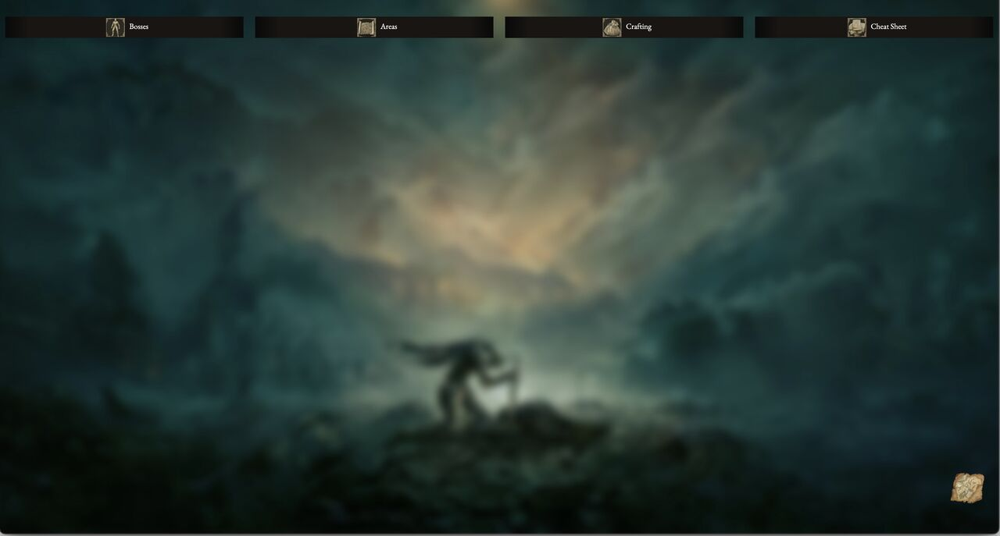
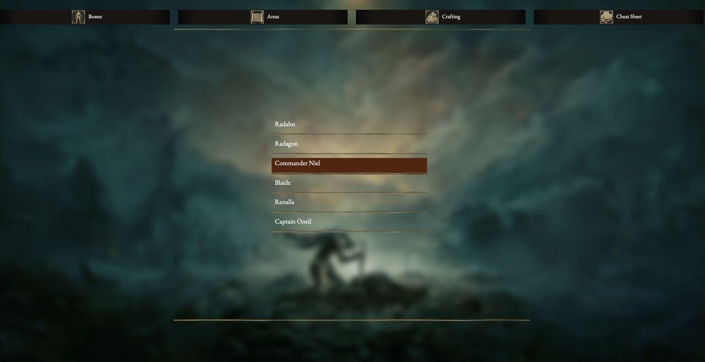
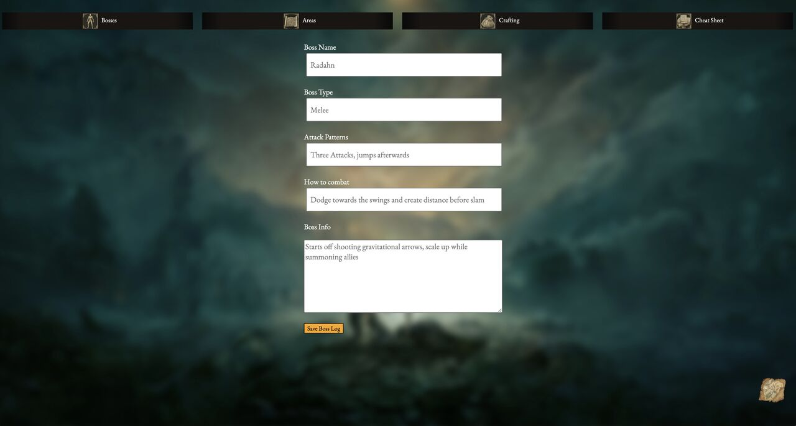
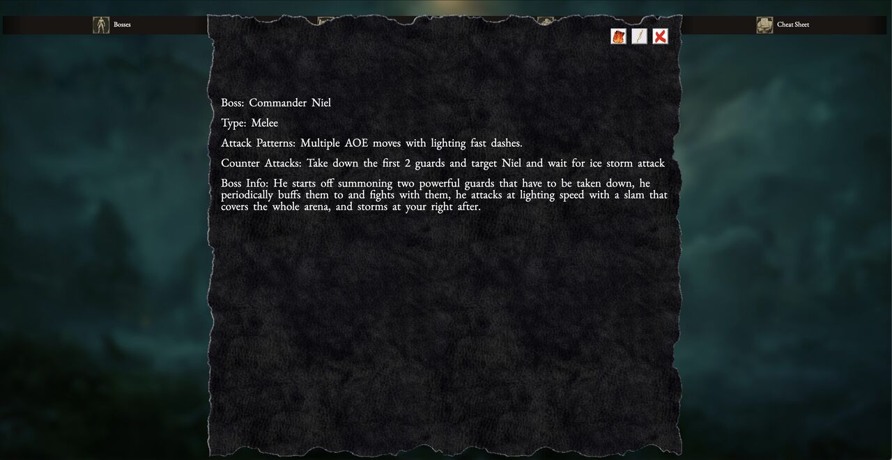

# Elden Ring Companion Hub

**Fan Companion App for Logging In-Game Strategies and Live Search**

[](https://developer.mozilla.org/en-US/docs/Web/JavaScript)
[](https://react.dev/)
[](https://axios-http.com/)

**[Live Demo](https://elden-ring-companion-hub.netlify.app/)**



## Overview

Elden Ring Companion Hub is a purely client-side fan companion app built for fellow Tarnished. Users can log and manage personal notes and strategies across bosses, areas, crafting, and a personal cheat sheet, with live search powered by the Elden Ring open-source API. All data is persisted locally via localStorage, requiring no backend or account.

**Core Features:**
- Log and manage notes and strategies across 4 categories: bosses, areas, crafting, and a cheat sheet
- Live search across 15 Elden Ring API categories for lore, drops, and locations
- Typo-tolerant client-side filtering and pagination, replacing the API's exact-match search
- Data persistence with localStorage, no account required
- UI designed to match the aesthetic of the Lands Between

## Screenshots

### Boss Log
Saved boss entries are listed for quick access.



### Logging a Strategy
Each entry captures the boss type, attack patterns, how to counter them, and general notes.



### Viewing and Editing an Entry
Open any saved entry to review it, edit it, or delete it.



## Tech Stack

**Frontend:**
- React
- JSX
- Axios (API requests)
- localStorage (client-side persistence)
- HTML5 / CSS3

## Architecture

### Component Structure
```
┌───────────────────────────────────┐
│            App.jsx                │
└──────────────┬────────────────────┘
               │
┌──────────────▼────────────────────┐
│            Components             │
│          - SearchBar              │
│          - NotesList              │
│          - NoteForm               │
│          - ResultCard             │
└──────────────┬────────────────────┘
               │
┌──────────────▼────────────────────┐
│           Data Layer              │
│     - Elden Ring API (Axios)      │
│        - localStorage             │
└───────────────────────────────────┘
```

### Data Flow

**Notes / Strategies**
- Created and managed via React state
- Persisted to localStorage on every update
- Loaded from localStorage on app mount

**Search**
- The Elden Ring API only supports exact-match name lookups, so results are fetched once per category with Axios
- Queries are then filtered client-side with typo-tolerant matching, so near-misses still return results
- Results are paginated and rendered as cards

## Installation

### Prerequisites
```bash
node -v   # v18 or higher recommended
```

### Setup
```bash
# Clone repository
git clone https://github.com/r-Dev03/Elden-Ring-Companion-Hub.git
cd Elden-Ring-Companion-Hub

# Install dependencies
npm install

# Start the app
npm start
```

Access the application at: `http://localhost:3000`

## Usage

### Search
- Use the search bar to query bosses, areas, items, and crafting materials
- Slight misspellings still match, and results are split into pages

### Notes & Strategies
- Add entries under bosses, areas, crafting, or the cheat sheet
- Entries are saved automatically to localStorage and persist across sessions
- Edit or delete entries at any time

## License

MIT License - see LICENSE file for details
